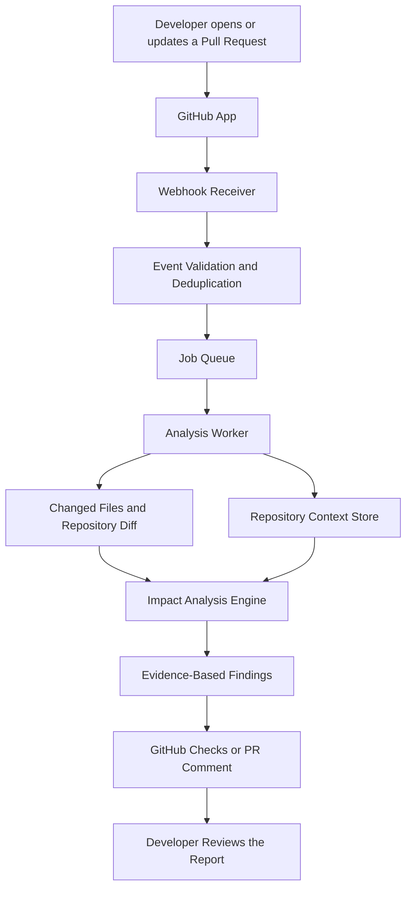

# Technical Architecture — UnvibeCode PR Intelligence

## 1. Purpose

This document describes the proposed technical architecture for UnvibeCode PR Intelligence.

The feature aims to analyze code changes in GitHub pull requests, identify potentially affected modules, and publish an evidence-based impact report directly in the developer's pull request workflow.

**Important:** This is a proposed architecture. It does not describe an existing or implemented UnvibeCode GitHub integration.

## 2. High-Level Architecture

The proposed system contains six main components:

1. GitHub App — connects UnvibeCode to selected repositories.
2. Webhook Receiver — receives pull request events from GitHub.
3. Job Queue — manages analysis requests without blocking webhook processing.
4. Analysis Worker — examines changed files and relevant repository context.
5. Context Store — maintains reusable repository information.
6. Report Publisher — publishes findings through GitHub Checks or pull request comments.

### Architecture Diagram

## 3. Component Responsibilities

### 3.1 GitHub App

The proposed GitHub App provides the connection between UnvibeCode and a developer's selected repositories.

Responsibilities:

- Allow developers to install the integration on selected repositories.
- Receive relevant pull request events.
- Access pull request metadata and changed-file information.
- Publish analysis results back to the pull request.

The integration should request only the minimum permissions necessary.

### 3.2 Webhook Receiver

The webhook receiver accepts events from GitHub when a pull request is opened, synchronized, or updated.

Responsibilities:

- Receive webhook events.
- Validate webhook signatures.
- Check repository and pull request details.
- Reject invalid or unsupported events.
- Prevent duplicate processing of the same pull request revision.
- Send valid analysis jobs to the queue.

Webhook processing should return quickly rather than waiting for the complete analysis.

### 3.3 Job Queue

The job queue manages analysis requests asynchronously.

Responsibilities:

- Store pending analysis jobs.
- Manage processing order.
- Support retries for temporary failures.
- Prevent repeated processing of identical revisions.
- Handle multiple pull requests without overloading the analysis service.

### 3.4 Analysis Worker

The analysis worker performs the main analysis.

Proposed workflow:

1. Retrieve the pull request diff and changed files.
2. Identify relevant modules and dependencies.
3. Retrieve related repository context.
4. Analyze possible downstream impacts.
5. Generate findings with supporting file and code references.
6. Send the results to the report publisher.

The analysis should prioritize changed files and connected modules instead of unnecessarily repeating a complete repository analysis for every pull request.

### 3.5 Repository Context Store

The context store maintains reusable information about the repository.

Potential information includes:

- Repository structure.
- Connected code relationships.
- Module and dependency information.
- Previously generated repository context.
- Context version and refresh status.

When the repository changes, the system should determine whether stored context is still valid and refresh outdated information when necessary.

This can reduce repeated analysis work and improve response time.

### 3.6 Report Publisher

The report publisher delivers the results to the developer.

Possible delivery methods:

- GitHub Checks for structured analysis status and results.
- Pull request comments for a readable summary.
- A link to a detailed UnvibeCode report, if supported by the product.

Each report should clearly display **Analyzed by UnvibeCode** so developers recognize the source of the analysis.

## 4. End-to-End Event Flow

The proposed processing sequence is:

1. A developer opens or updates a pull request.
2. GitHub sends an event to the UnvibeCode webhook endpoint.
3. The receiver validates the event and checks for duplicate requests.
4. A valid request is added to the job queue.
5. An analysis worker retrieves the changed files and relevant repository context.
6. The analysis engine identifies potentially affected modules.
7. Findings are generated with supporting evidence.
8. The report publisher sends the results to GitHub.
9. The developer reviews the report and makes any necessary changes.

## 5. Example Analysis Report

The following is an illustrative example, not an actual result from the current product.

**Pull Request:** Update payment processing

**Analysis status:** Completed

**Changed area:** Payment module

**Potential impact:**
- Order processing may depend on the modified payment functionality.
- Related payment validation logic may require review.
- Relevant connected modules should be checked before merging.

**Evidence:**
- Changed file references.
- Related module references.
- Explanation of why each potential impact was identified.

**Recommendation:** Review the identified connected modules and run the relevant tests before merging.

The report should distinguish potential impacts from confirmed defects. It must not present an inferred relationship as a guaranteed bug.

## 6. Reliability and Failure Handling

The integration should communicate its processing status clearly.

| Situation | Expected behavior |
|---|---|
| Analysis in progress | Display an in-progress status |
| Analysis completed | Publish the report |
| Partial analysis | Show available results and explain what is missing |
| Temporary service failure | Retry within defined limits |
| Invalid webhook | Reject the event |
| Duplicate event | Avoid duplicate analysis |
| Analysis failure | Show a clear failure status |

A failed analysis should never be presented as a successful or complete report.

## 7. Security and Privacy

Security should be considered from the beginning.

Proposed safeguards:

- Use least-privilege GitHub App permissions.
- Validate webhook signatures.
- Store credentials securely.
- Protect repository information and analysis results.
- Avoid logging sensitive source-code content unnecessarily.
- Restrict access to reports to authorized users.
- Provide a way to disconnect the integration.
- Define clear data retention and deletion policies.

## 8. Performance and Cost Considerations

Repeated full-repository analysis could increase processing time and API costs.

The proposed architecture addresses this through:

- Reusing repository context where valid.
- Prioritizing changed files and related modules.
- Avoiding duplicate analysis for the same pull request revision.
- Using asynchronous background jobs.
- Applying timeouts and controlled retries.
- Tracking processing time and resource consumption.

The system should also provide a clear fallback when the analysis service is unavailable.

## 9. Technical Feasibility and Open Questions

GitHub provides established mechanisms for repository integrations, webhook events, pull request information, and Checks.

However, the feasibility of connecting these mechanisms to UnvibeCode's analysis engine must be validated.

Questions to investigate before implementation:

1. Can UnvibeCode's existing repository analysis and context-generation capabilities be called reliably through an API or service interface?
2. Can the analysis engine process only changed files and their relevant connected modules?
3. How should repository context be stored, refreshed, and invalidated?
4. What processing limits and API costs apply to repeated pull request analysis?
5. What repository permissions and data-retention policies are appropriate?

These are implementation dependencies, not capabilities assumed to exist today.

## 10. Conclusion

UnvibeCode PR Intelligence proposes connecting repository analysis to the recurring GitHub pull request workflow.

By combining GitHub events, reusable repository context, focused impact analysis, and visible reports, the feature aims to make UnvibeCode useful beyond a developer's first trial.

The architecture prioritizes repeat usage, low workflow friction, evidence-based findings, security, and manageable analysis costs.
